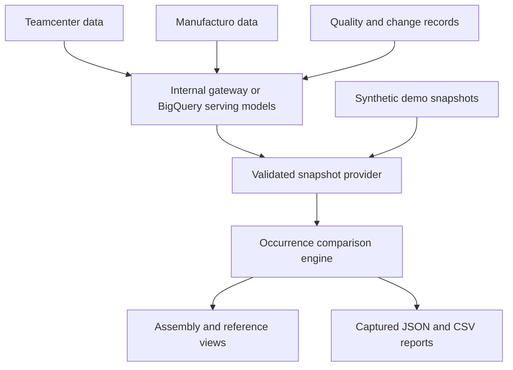

# Architecture and comparison semantics

The live upstream paths are integration contracts awaiting work-environment implementation. The supplied demo provider is functional. The application uses Node's built-in HTTP/crypto/fs/fetch/test facilities and a vanilla ES-module UI: no frontend build pipeline or third-party runtime packages.

## Matching order

1. Match equal canonical occurrence keys across snapshots. This can locate an occurrence moved to another parent, and it takes precedence over root alignment: if A's root is a keyed subassembly inside B, it maps to that subassembly and a scope warning is shown.
2. If both roots are still unmatched, align them as the comparison anchor. Different root PNs remain an explicit difference and warning.
3. Within aligned parents only, match a unique exact reference-designator set.
4. Within aligned parents only, match a unique exact part number.
5. Within aligned parents only, pair a repeated same-PN group when the whole group is the same multiset of content (attributes, records and entire subtree, excluding snapshot-local ids) on both sides. Any pairing among interchangeable occurrences yields identical rows, so a snapshot compared with itself reports no changes. Partial overlaps stay unresolved; this step never makes a leftover occurrence "unique". Repeat steps 3–5 as new parent pairs become available.
6. Keep all unmatched occurrences visible. Possible correspondence based on an unmatched PN/reference marks them unresolved. Conflicting authoritative keys are never overridden by heuristic matches.
7. Flag, without re-pairing, two kinds of matched correspondence as unresolved: a designator match that changes PN while a same-PN candidate under the same parent is not matched to its own PN (for example two parts that swapped designators), and a canonical key that now names a different part while an unmatched occurrence of the original part remains in the original location (a likely reused key).

There is no global part-number join, fuzzy name matching or silently selected first duplicate. Without canonical mappings, a part whose parent and PN both change may remain added/removed or unresolved. That is deliberate: the inputs do not establish a defensible correspondence.

## Change fields

Matched occurrences compare PN, revision, local quantity (absolute tolerance `1e-9`), unit, order-independent reference set, parent correspondence, and description. More than one flag may apply. An unmatched occurrence has Added/Removed status, with a separate correspondence warning when needed.

The main changed count is the number of distinct changed occurrences, not the number of flags. Root changes count. Ancestor totals count changed descendants without inventing a change to the parent itself. “Affected A subassemblies” counts top-level baseline branches containing changes; new B-only branches are available in the B explorer but do not inflate this A-only metric.

Reference designators are compared as full assignment sets. Changed PN sets are Reassigned; a revision-only change on the same mapped occurrences is Revised; unmatched occurrence correspondence is Relocated; one-sided sets are Added/Removed. A reference still assigned to the same mapped occurrence is unchanged even if that occurrence moves; the occurrence view records its move. Duplicate references remain visible and may require a source-specific scope extension.

“Source explained” counts changed occurrences whose **every** change type is declared by a qualifying `explains` record (`record.changes`). A record does not qualify when it appears with the same source, id and status on both snapshots (pre-existing context), or when its `serialNumber` is outside the comparison. Rows are labelled Explained, Partially explained (uncovered changes listed), Linked with no declared scope, Related records only, or No linked record; only Explained rows leave the “Needs source explanation” queue. Explained never means approved, and an NC's existence never proves causality. Inspect the actual record and disposition.

## Limits that must stay visible

- Input is one resolved tree per snapshot. Source DAGs with reused assemblies must be expanded into distinct usages with stable occurrence identities.
- Quantity rollups/explosion, unit conversion, manufacturing consumption/yield and equivalence rules are not implemented.
- Effective dates, option/variant selection, latest-revision rules and serial membership must be resolved by the provider. Snapshot selectors do not infer these rules.
- No CAD geometry, ERP cost comparison, engineering approval workflow or source writeback.
- Reference-designator case is significant. IDs/PNs/revisions are compared as supplied; normalize only with an approved mapping rule.
- Source headers and all supplied node records are included in JSON exports. Apply data minimization in the gateway.
- Demo directory providers read/validate all snapshot files per request; use an indexed gateway for larger live catalogs.
- Engine input is capped at 20,000 occurrences per side, 128 hierarchy depth. The result table paginates 100 rows; it still loads the complete report in memory. A 5,000-repeat ambiguity test exercises the nonquadratic unmatched scan, not a production concurrency SLA.
- SHA-256 fingerprints canonicalize object-key ordering but retain array order and source metadata. They identify exact source representations, not semantic equality across reordered source records.
- No durable history. Eight runs live only in tab memory. Download the JSON report for a persistent comparison record.
